<a href="https://rida-taki.vercel.app/">
  
</a>

  
  
  
  


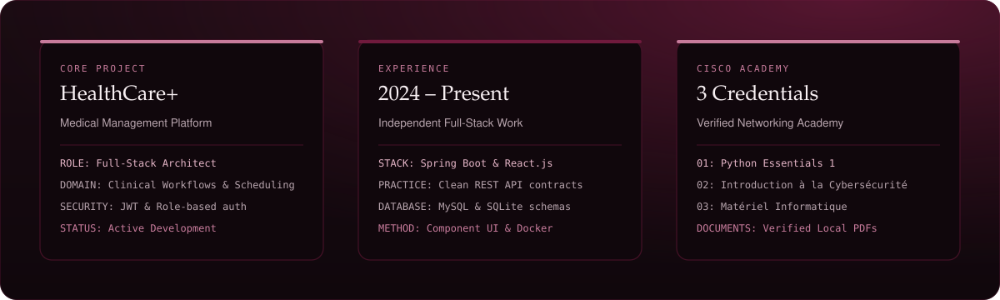


<a href="https://github.com/Rida1019-taki">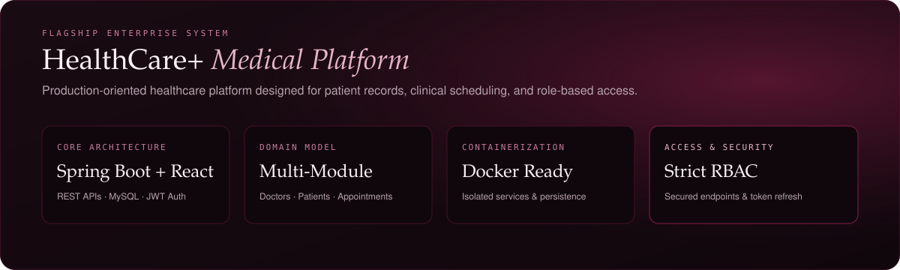</a>

  
  

<a href="https://github.com/Rida1019-taki">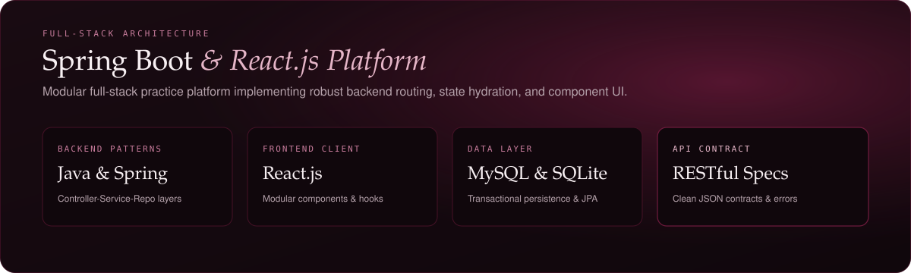</a>

  

<a href="https://github.com/Rida1019-taki">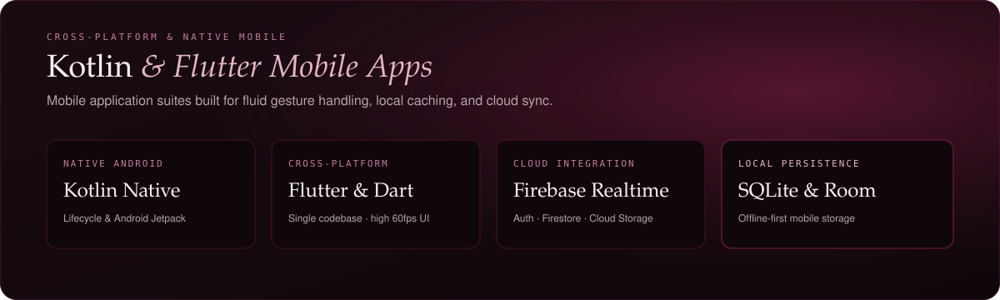</a>

  

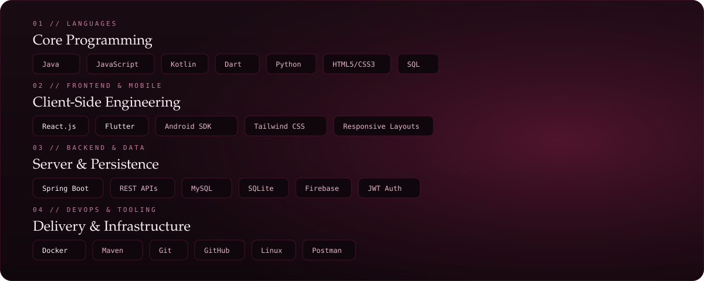

<a href="https://github.com/Rida1019-taki"></a>

  
  &nbsp;
  

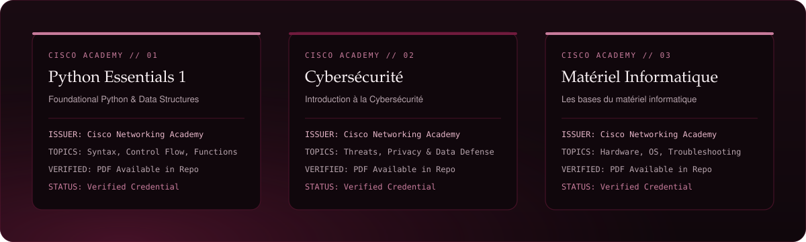

  
  
  


  
  
  
  

<a href="https://rida-taki.vercel.app/">
  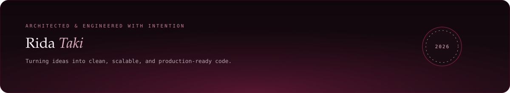
</a>
