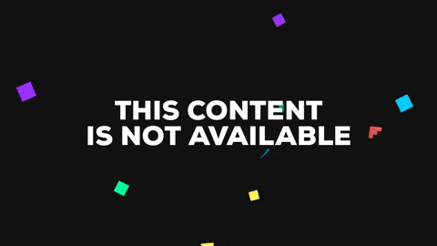

<!-- 🎬 00 // HERO: GRAND LINE LOG POSE BROADCAST -->

  

 

<!-- 🏴‍☠️ 01 // MY PIRATE CODE: THE WILL OF D -->

  

<!-- ⚡ 02 // DEVIL FRUIT & HAKI ARSENAL -->

  

<!-- 🪪 03 // PIRATE WANTED POSTER & FLEET DASHBOARD -->

  

## 🏴‍☠️ Grand Line Legendary Voyages

<table>
  <thead>
    <tr>
      <th>Voyage / Mission</th>
      <th>Log Entry (What it is)</th>
      <th>Haki &amp; Fruit Used</th>
      <th align="center">Bounty Status</th>
    </tr>
  </thead>
  <tbody>
    <tr>
      <td><a href="https://github.com/Rida1019-taki"><b>🏥 HealthCare+ Platform</b></a></td>
      <td>Production-ready medical management system with multi-module domain architecture and JWT security</td>
      <td><code>Spring Boot</code> <code>React.js</code> <code>MySQL</code> <code>Docker</code></td>
      <td align="center"><b>👑 S-Rank</b></td>
    </tr>
    <tr>
      <td><a href="https://github.com/Rida1019-taki"><b>🎓 Spring &amp; React Ecosystem</b></a></td>
      <td>Full-stack educational platform with clean layered MVC pattern, JPA persistence, and REST APIs</td>
      <td><code>Java</code> <code>Spring Boot</code> <code>React.js</code> <code>REST</code></td>
      <td align="center"><b>⚓ Active</b></td>
    </tr>
    <tr>
      <td><a href="https://github.com/Rida1019-taki"><b>📱 Cross-Ocean Mobile Apps</b></a></td>
      <td>Native Android and cross-platform apps with real-time Firebase sync, SQLite local storage, and responsive UI</td>
      <td><code>Kotlin</code> <code>Flutter</code> <code>Dart</code> <code>Firebase</code></td>
      <td align="center"><b>🚀 Shipped</b></td>
    </tr>
    <tr>
      <td><a href="./Python%20Essentials%201.pdf"><b>🛡️ Cisco Marine Academy</b></a></td>
      <td>Three verified certifications: Python Essentials 1, Introduction to Cybersecurity, and IT Hardware Basics</td>
      <td><code>Python</code> <code>Cybersecurity</code> <code>Networking</code></td>
      <td align="center"><b>📜 Verified</b></td>
    </tr>
    <tr>
      <td><a href="https://rida-taki.vercel.app/"><b>🧭 Grand Line Portfolio</b></a></td>
      <td>Interactive digital portfolio and live project showcase navigating modern full-stack web experiences</td>
      <td><code>TypeScript</code> <code>React</code> <code>Tailwind</code> <code>Vercel</code></td>
      <td align="center"><b>⭐ Live Demo</b></td>
    </tr>
  </tbody>
</table>

<a href="https://github.com/Rida1019-taki?tab=repositories"><b>→ Explore all 46 Charted Repositories</b></a>

  

### 🌊 Grand Line Nautical Log

*Every commit charts another nautical league across the digital sea — rebuilt automatically every day.*

  

<!-- 🐌 05 // JOIN THE CREW: DEN DEN MUSHI ALLIANCE -->

  
  
  
  

 

  

 

**"Kaizoku ou ni, ore wa naru! (I'm gonna be the King of the Developers!) Keep coding, keep sailing." 🏴‍☠️🍖⚓**

